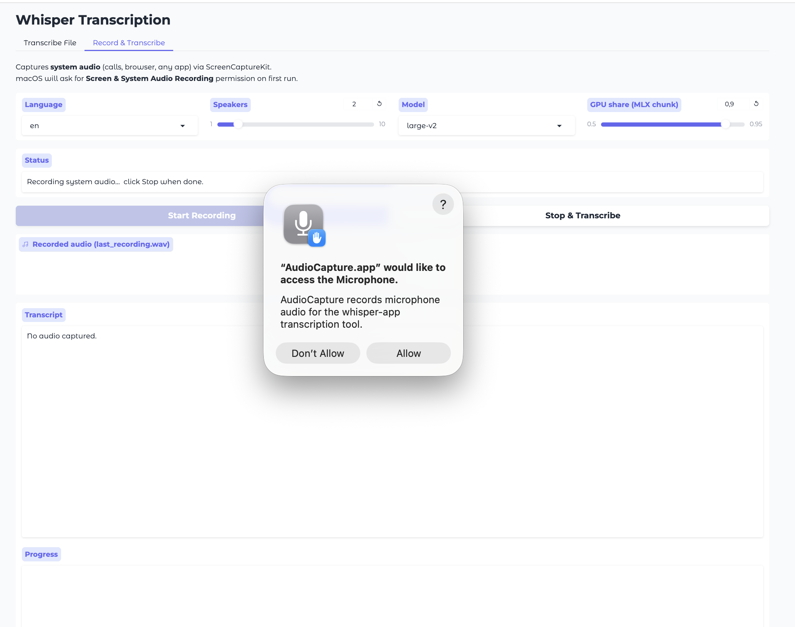
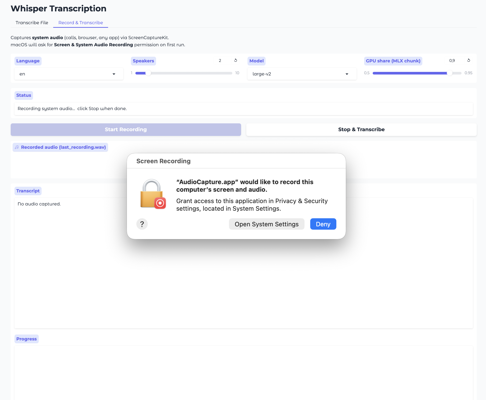
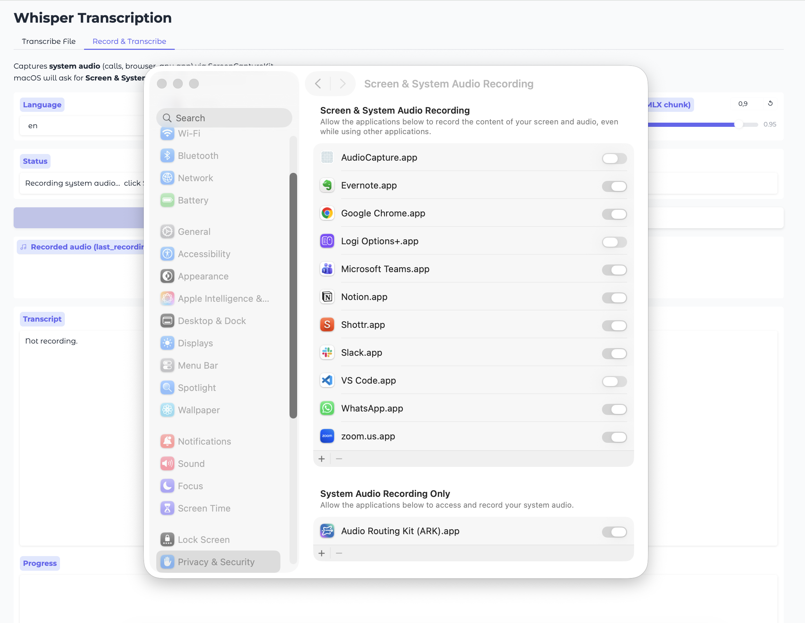
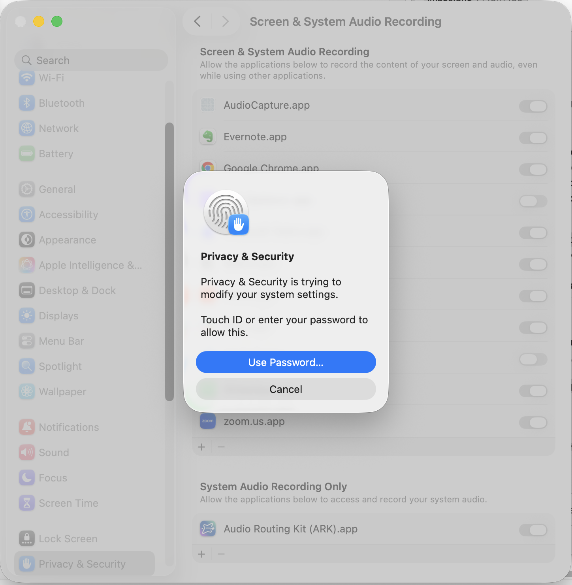
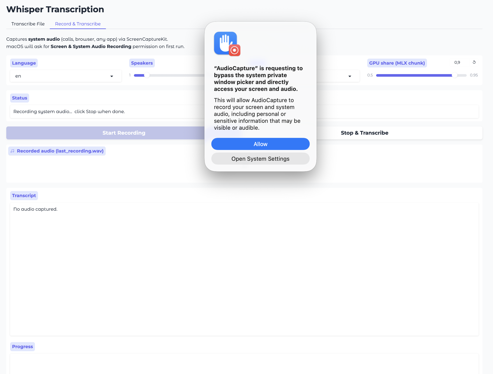
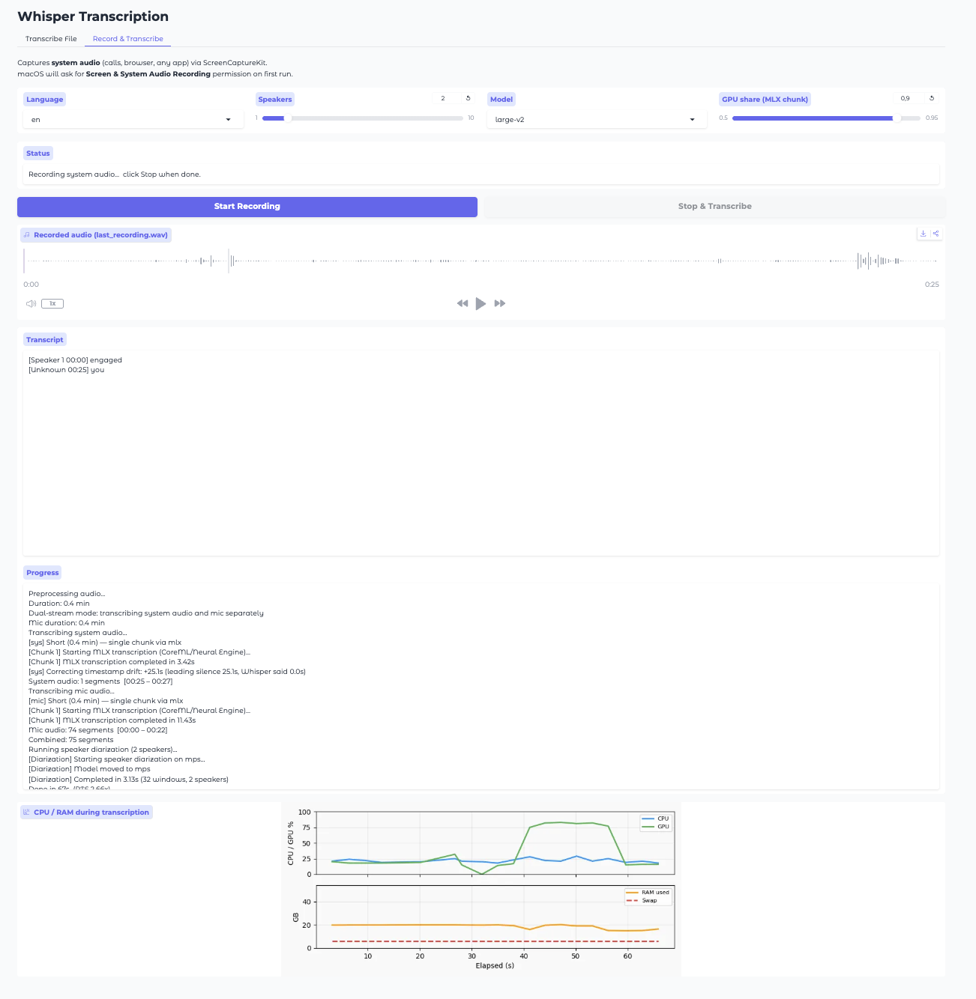

# Whisper Transcription

Local Whisper-based transcription for macOS Apple Silicon, with a Gradio UI for both file uploads and live system-audio recording (via ScreenCaptureKit). The pipeline runs faster-whisper on CPU and MLX Whisper on the Neural Engine in parallel, then performs speaker diarization with SpeechBrain.

## Requirements

- macOS on Apple Silicon (M1 / M2 / M3 / M4)
- Python 3.12+
- [uv](https://github.com/astral-sh/uv) for dependency management
- ffmpeg

```bash
brew install uv ffmpeg
```

## Install

```bash
git clone <repo-url> whisper
cd whisper
uv sync                  # creates .venv and installs all dependencies
./build_audio_capture.sh # builds the Swift ScreenCaptureKit binary into AudioCapture.app/
```

## Run

```bash
./whisper-app
```

This opens the Gradio UI at `http://127.0.0.1:7860`. Two tabs:

- **Transcribe File** — drop in an audio or video file, get back a speaker-labeled transcript
- **Record & Transcribe** — start/stop recording of system audio (calls, browser, any app), then transcribe automatically when you stop

Defaults (language, number of speakers, model size, GPU/CPU split) are stored in `.app_settings.json` and persist across runs.

## Grant macOS permissions (first run only)

The Record & Transcribe tab needs three permissions for the `AudioCapture.app` helper. The first time you click *Start Recording*, macOS shows them in sequence:

**1. Microphone** — click *Allow*.



**2. Screen & System Audio Recording** — Sequoia shows *Open System Settings* / *Deny*. Click **Open System Settings** (do not click Deny — denying makes the prompt never re-fire).



System Settings opens to *Privacy & Security → Screen & System Audio Recording*. `AudioCapture.app` is at the top with the toggle OFF — flip it ON.



macOS asks for Touch ID or your password to confirm.



**3. The Sequoia persistent-grant prompt.** Go back to the Gradio UI and click *Start Recording* again. macOS shows one more dialog asking AudioCapture to *bypass the system private window picker* so it can capture audio without the system content-picker appearing every time. Click **Allow**.



Recording now works — system audio + your microphone are written to `last_recording.wav` and `last_recording_mic.wav`, transcribed, and you get a speaker-labeled transcript with timestamps.



**If you accidentally clicked *Deny* or *Don't Allow*** on any prompt, that prompt will not re-fire. To recover, open *System Settings → Privacy & Security* and either toggle the entry on (if listed under Microphone / Screen & System Audio Recording) or click `+` and add `AudioCapture.app` from your repo path.

## How it works

The pipeline:

1. Resamples to 16 kHz mono via ffmpeg
2. Keeps only the voiced parts (Silero VAD), so Whisper never sees long silences — this is both faster and stops it from inventing text on silence
3. For more than 3 minutes of speech, splits it into two overlapping chunks and transcribes chunk 1 on CPU (faster-whisper) and chunk 2 on the Apple Neural Engine (MLX Whisper) **in parallel**, then merges segments using the overlap region; shorter speech is processed as a single chunk on whichever backend is available
4. Maps timestamps back to the original recording and drops known Whisper hallucinations (subtitle credits, "thanks for watching", …)
5. Runs SpeechBrain ECAPA-TDNN speaker embeddings + agglomerative clustering for diarization
6. Assigns speakers to transcript segments by overlap

See [ARCHITECTURE.md](ARCHITECTURE.md) for the deep dive.

## Performance

Rough numbers for a 1-hour audio file on M4, `large-v2` model:

| Method | Time | Speedup |
|--------|------|---------|
| faster-whisper CPU only | ~60 min | 1× |
| Parallel CPU + MLX | ~15 min | 4× |

Actual times vary by model size, language, and audio complexity.

## Project layout

```
whisper_app.py            Gradio UI entry point
whisper-app               Bash shim → `uv run python whisper_app.py`
transcribe_pipeline.py    Orchestration: preprocess → split → parallel → merge → diarize
transcribe_workers.py     Backend workers (faster-whisper, MLX, whisper.cpp, speechbrain)
AudioCapture/             Swift ScreenCaptureKit CLI source
build_audio_capture.sh    Builds AudioCapture.app
.app_settings.json        Persisted UI defaults
pyproject.toml + uv.lock  Dependency manifest
```

## Troubleshooting

- **`./whisper-app` fails with "uv: command not found"** — `brew install uv`
- **`./build_audio_capture.sh` fails** — install Xcode command line tools (`xcode-select --install`)
- **No system audio captured** — grant *Screen & System Audio Recording* permission to `AudioCapture.app` in System Settings → Privacy & Security (see [Grant macOS permissions](#grant-macos-permissions-first-run-only))
- **System Settings shows "AudioCapture" (no .app, exec icon) instead of "AudioCapture.app"** — your build is missing `Contents/Info.plist`. Pull the latest `build_audio_capture.sh` and rebuild.
- **AudioCapture doesn't appear in System Settings even after the prompt** — make sure your clone lives under a real path (e.g. `~/Dev/whisper`) and not `/tmp` or another non-indexed location. macOS needs LaunchServices to find the bundle to display it.
- **`mlx_whisper` not detected** — pipeline falls back to CPU faster-whisper on both chunks; check `uv pip list | grep mlx` to confirm install
